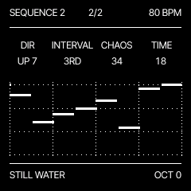

# DRIFT

**An ambient instrument for M-VAVE FM-1.** Classic synth sounds, warm basses, pads and plucks, with a repeating generative Euclidean sequencer. Minimal monochrome interface, one sequencer track and eight voices.

By **Fabian Freitag**. Based on [Felucca](https://github.com/hugelton/Felucca) by Leo Kuroshita / Hügelton Instruments.

[Project website](https://www.fbnfrtg.de/tools/fm1/drift/) · [Play in your browser](https://www.fbnfrtg.de/tools/fm1/drift/webplayer/) · [Install firmware](https://www.fbnfrtg.de/tools/fm1/drift/webplayer/install/) · [Manual](https://www.fbnfrtg.de/tools/fm1/drift/manual.html) · [Releases](https://github.com/FBNFRTG/drift-fm1/releases)

## Features

- Two oscillators; oscillator 2 starts with OFF. Classic waveforms and three user sample slots.
- ADSR envelope, resonant filter, assignable LFO and 80 BPM default tempo.
- Classic, Ping Pong and Reverse delay; Room, Spring, Hall, Space, Shimmer and Submarine reverb.
- Repeating Euclidean patterns: bars, note count, duration and probability; direction, interval, chaos and timing variations. Editing keeps the transport running.
- Root, scale and note range; optional scale LEDs and scale-only keyboard.
- Six-row patch list, favourites, save under a new name, overwrite confirmation and delete confirmation.
- Browser player, USB-MIDI firmware installer and sample uploader.

## Controls

| Control | Function |
| --- | --- |
| HOME / PATCHES | Patch list / select patch; HOME again opens delete confirmation |
| REC / SAVE | Favourite / save patch |
| GLO | Oscillator 1 / oscillator 2 |
| ENV / EDIT / LFO | ADSR / filter / modulation |
| FX | Sends / space settings / effect types |
| SCL | Root, scale and range / scale LEDs and scale-only mode |
| ARP / SEQ | Sequence 1 / sequence 2 |
| SELECT / ALGORITHM | Tempo / low-pass filter |
| PLAY / OCT− / OCT+ | Transport / live keyboard octave |

See the [English manual](https://www.fbnfrtg.de/tools/fm1/drift/manual.html) or [detailed German notes](README-DRIFT.md).

## Install and release status

Release **0.8**, identity **FM-1_983**, update loader **ota-FM-1_983**. This identity stays fixed across versions.
Use the `.fwsc` attached to a GitHub release, or the website installer in desktop Chrome or Edge over HTTPS. Keep power and USB connected during installation.

Software build, native synthesis/persistence, WebAssembly and simulated update/loader checks passed for the supplied 0.8 binary. Physical installation, outgoing updates and recovery for this exact release still require verification on a real FM-1 before Firmware Hub submission. Earlier user-tested builds do not replace testing this package.

The 0.8 update retains the DRIFT 0.7 patch/sample storage layout. Other firmwares' projects and samples are not guaranteed compatible. Back up your data before updating or switching firmware.

## Samples

Three slots, each up to approximately 7.38 seconds, mono, 22,050 Hz; stored as 4-bit IMA ADPCM. The [sample uploader](https://www.fbnfrtg.de/tools/fm1/drift/webplayer/samples/) converts supported audio locally. Stereo is downmixed.

## Build and contribute

[Build instructions](BUILDING.md) · [Changes](CHANGES-DRIFT.md) · [Contributing](CONTRIBUTING.md) · [Publishing instructions](PUBLISHING-DE.md)

All engine sources are included directly. Internal `felucca` filenames and symbols are retained where they are build dependencies; they are not a separate product download.

## Licence and credits

DRIFT is distributed under **GPL-3.0-only**, with the third-party licences and notices documented in [LICENSING.md](LICENSING.md), [CREDITS.md](CREDITS.md), [LICENSE](LICENSE) and `LICENSES/`. Preserve these notices when redistributing.

Independent firmware; not affiliated with M-VAVE. [Impressum / Legal notice](https://www.fbnfrtg.de/impressum/).
